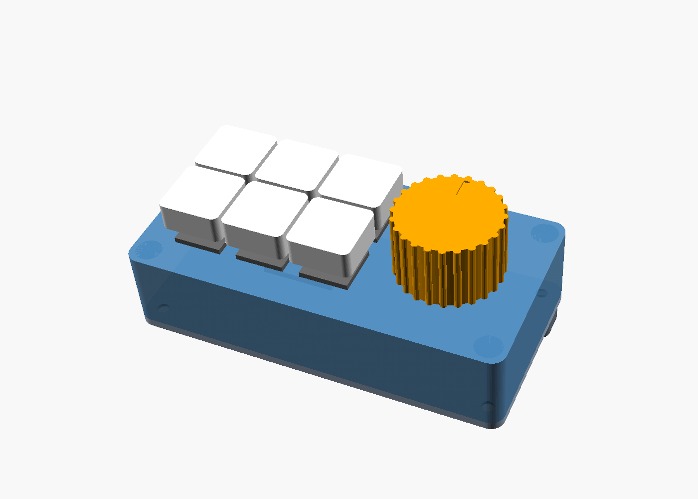

# Stream deck: 6 tangenter + vridratt, ESP32-C6

En liten makropanel med sex mekaniska tangenter och en rotary encoder med
tryckknapp. Den kopplar upp sig mot datorn trådlöst som ett **Bluetooth-tangentbord
med mediaknappar** och behöver varken drivrutiner eller program på datorn.
Chassit skrivs ut på en Bambu Lab P2S (eller vilken FDM-skrivare som helst)
utan support.



```
        bak (USB-C)
   +----+----+----+
   | 1  | 2  | 3  |   ( ratt )
   +----+----+----+
   | 4  | 5  | 6  |
   +----+----+----+
        fram
```

**Varför Bluetooth och inte USB?** ESP32-C6 saknar USB-enhetsstöd: USB-porten
är bara en seriell port/JTAG för programmering och kan inte bli ett
USB-tangentbord. Däremot har C6:an Bluetooth LE, och ett BLE-tangentbord
fungerar direkt i Windows, macOS, Linux, Android och iOS. USB-kabeln används
för ström och för att ladda upp koden.

## Innehåll

```
stream-deck/
├── firmware/              PlatformIO-projekt
│   ├── platformio.ini
│   ├── include/config.h   ← pinnar, namn och vad varje knapp gör
│   ├── include/keycodes.h tangentkoder (KEY_F13, MEDIA_VOL_UP ...)
│   └── src/               main.cpp, ble_hid.cpp
└── case/
    ├── stream_deck.scad   parametriskt chassi (OpenSCAD)
    ├── preview.png
    └── stl/               färdiga filer att skriva ut
        ├── top.stl        överdel med switchplatta
        ├── bottom.stl     bottenplatta med hållare för kortet
        ├── riser.stl      lutningsfot bak (valfri)
        └── knob.stl       ratt
```

## Det här behöver du

| Antal | Del | Kommentar |
|---|---|---|
| 1 | Seeed Studio XIAO ESP32C6 | Chassit är måttsatt för den. ESP32-C6-DevKitC-1 fungerar med samma kod, men då måste kortmåtten i `.scad`-filen ändras (se nedan). |
| 6 | Mekaniska switchar, MX-kompatibla | t.ex. Gateron, Kailh, Cherry. Med 3 eller 5 ben spelar ingen roll. |
| 6 | Keycaps 1u, MX-fäste | |
| 1 | EC11 rotary encoder **med tryckknapp**, D-axel, 20 mm axellängd | Mutter och bricka brukar följa med. |
| 2 | M3×8 skruv | fram |
| 2 | M3×12 skruv | bak, genom lutningsfoten (utan foten: 4× M3×8) |
| 4 | Gummifötter, max 10 mm i diameter | valfritt |
| – | Tunn kopplingstråd (26–28 AWG), lödpenna | |
| 1 | 3 mm lysdiod + 330 Ω motstånd | valfritt, statuslampa i locket |

## 1. Skriv ut chassit (Bambu P2S)

Öppna STL-filerna i Bambu Studio. **Alla delar skrivs ut utan support**, i den
orientering som filerna redan har:

| Fil | Orientering | Tips |
|---|---|---|
| `top.stl` | upp och ner, ovansidan mot plattan | Ger en slät ovansida. |
| `bottom.stl` | som den ligger | |
| `riser.stl` | som den ligger | Bara om du vill att panelen lutar ca 5°. |
| `knob.stl` | upp och ner | Prova passningen på axeln först; ändra `fit` vid behov. |

Inställningar som fungerar bra: PLA eller PETG, 0,2 mm lagerhöjd
(0,12 mm för ratten), 3 väggar, 15 % infill och Textured PEI-platta.
Allt får plats på en enda platta.

**Passning:** hålen för switcharna är 14,0 mm (standard). Om switcharna sitter
för hårt eller inte går i, ändra `sw_hole` till 14,1–14,2 och exportera igen.
Hålet för encodern är 7,4 mm.

### Ändra chassit

`case/stream_deck.scad` är parametriskt: alla mått finns överst i filen. Ändra
i OpenSCAD (gratis, openscad.org) och exportera med F6 → *Export as STL*,
eller från kommandoraden:

```bash
openscad -D 'part="top"' -o stl/top.stl stream_deck.scad
```

Vanliga ändringar:

- **Annat kort:** sätt `board_w` (bredd över USB-änden) och `board_l`. USB-hålet
  i bakväggen följer med automatiskt (`board_x` flyttar det i sidled).
- **Encoderns stopptapp:** EC11 har en liten tapp bredvid axeln. Bryt av den med
  en tång (enklast), eller sätt `enc_tab = true` för ett spår i locket.
- **Kortare/längre encoderaxel:** ändra `shaft_len` (15/20/25 mm) så att ratten
  hamnar rätt.

## 2. Koppla

Varje switch kopplas mellan sin pinne och GND. Inga motstånd eller dioder
behövs, eftersom chipets interna pull-up-motstånd används.

| Funktion | GPIO | XIAO ESP32C6 | DevKitC-1 |
|---|---|---|---|
| Tangent 1 | 0 | D0 | 0 |
| Tangent 2 | 1 | D1 | 1 |
| Tangent 3 | 2 | D2 | 2 |
| Tangent 4 | 21 | D3 | 21 |
| Tangent 5 | 22 | D4 | 22 |
| Tangent 6 | 23 | D5 | 23 |
| Encoder A | 19 | D8 | 19 |
| Encoder B | 20 | D9 | 20 |
| Encoder tryck | 18 | D10 | 18 |
| Statuslampa (valfri) | 17 | D7 | – |
| GND | – | GND | GND |

```
  XIAO D0 ────── switch 1 ──┐
  XIAO D1 ────── switch 2 ──┤
  XIAO D2 ────── switch 3 ──┤
  XIAO D3 ────── switch 4 ──┤
  XIAO D4 ────── switch 5 ──┤
  XIAO D5 ────── switch 6 ──┤
                            ├──── XIAO GND
  EC11, sidan med 3 ben:    │
     A ──── D8              │
     C (mitten) ────────────┤
     B ──── D9              │
  EC11, sidan med 2 ben:    │
     SW ─── D10             │
     SW ────────────────────┘
```

Tips: dra en enda GND-tråd i en slinga från switch till switch och vidare till
encodern. Då blir det bara en tråd per switch till kortet.

**Monteringsordning:**

1. Tryck fast de sex switcharna i locket från ovansidan. De snäpper fast.
2. Bryt av encoderns stopptapp. Sätt encodern underifrån och dra åt muttern
   på ovansidan.
3. Löd trådarna på switcharna och encodern, sedan på kortet.
4. Lägg kortet i hållaren på bottenplattan med USB-C-kontakten mot hålet
   i bakväggen.
5. Ladda upp koden och testa (steg 3) **innan** du skruvar ihop chassit.
6. Skruva ihop: M3×8 fram, M3×12 bak genom lutningsfoten. Tryck på ratten
   och keycaps.

XIAO:ns inbyggda lampa syns bara när chassit är öppet. Vill du se lager och
anslutning utifrån behöver du den valfria statuslampan: löd en 3 mm lysdiod i hålet bredvid ratten, med anoden
(det långa benet) via ett 330 Ω motstånd till D7 och katoden till GND. Sätt
sedan `EXTRA_LED_PIN 17` i `config.h`.

## 3. Ladda upp koden

Koden är ett [PlatformIO](https://platformio.org/)-projekt. Enklast är VS Code
med tillägget *PlatformIO IDE*. Där väljer du *Open Folder* på
`stream-deck/firmware`, sätter i XIAO:n med USB-C och klickar på pilen
(*Upload*). Från terminalen:

```bash
cd stream-deck/firmware
```

```bash
pio run -e xiao_esp32c6 -t upload
```

För DevKitC-1 använder du `-e esp32c6_devkitc`. Första bygget tar några minuter,
eftersom ESP32-C6-verktygen och NimBLE-biblioteket laddas ner.

Vill du följa loggen (vilka knappar som trycks, anslutning och lager):

```bash
pio device monitor
```

> Om uppladdningen inte startar: håll in **BOOT** på XIAO:n, tryck på **RESET**,
> släpp BOOT och försök igen.

<details>
<summary>Arduino IDE i stället för PlatformIO</summary>

1. Installera kortpaketet *esp32* av Espressif, **version 3.x**, och biblioteket
   *NimBLE-Arduino* av h2zero, **version 2.x**.
2. Skapa en skiss som heter `stream_deck`. Kopiera innehållet i `src/main.cpp`
   till `stream_deck.ino` och lägg `ble_hid.cpp`, `ble_hid.h` och allt i
   `include/` i samma mapp.
3. Har du DevKitC-1: lägg till `#define BOARD_ESP32C6_DEVKITC` överst i
   `config.h`. För XIAO behövs ingen ändring.
4. Välj kortet (*XIAO_ESP32C6* eller *ESP32C6 Dev Module*) och ladda upp.

</details>

## 4. Para ihop med datorn

1. Ge panelen ström via USB-C, från datorn eller en mobilladdare. Lampan
   blinkar kort var 1,5:e sekund medan den väntar på en anslutning.
2. På datorn: **Inställningar → Bluetooth → Lägg till enhet**. Välj
   **Stream Deck C6**.
3. Klart. Nästa gång ansluter den automatiskt.

**Byta dator / glömma gamla parkopplingar:** håll in tangent 1 och ratten
samtidigt när du ger panelen ström. Lampan blinkar tio gånger. Ta också bort
enheten i datorns Bluetooth-lista innan du parar om.

## 5. Använda den

Panelen har tre **lager**. **Håll in ratten i 0,6 s** för att byta lager.
Lampan blinkar 1, 2 eller 3 gånger och visar vilket lager du är på. Valt lager
sparas även när strömmen bryts.

| | Lager 1 "F-keys" | Lager 2 "Media" | Lager 3 "Edit" |
|---|---|---|---|
| Tangent 1 | F13 | Föregående låt | Kopiera (Ctrl+C) |
| Tangent 2 | F14 | Play/paus | Klistra in (Ctrl+V) |
| Tangent 3 | F15 | Nästa låt | Klipp ut (Ctrl+X) |
| Tangent 4 | F16 | Mikrofon av/på i Teams | Spara (Ctrl+S) |
| Tangent 5 | F17 | Kamera av/på i Teams | Sök (Ctrl+F) |
| Tangent 6 | F18 | Skärmklipp (Win+Shift+S) | Visa skrivbordet (Win+D) |
| Vrid höger / vänster | Volym upp / ner | Volym upp / ner | Gör om / ångra |
| Klick på ratten | Ljud av | Play/paus | Enter |

**F13–F18** finns inte på vanliga tangentbord, så de krockar aldrig med något.
Bind dem i OBS (*Inställningar → Snabbtangenter*), Discord (*Tangentbindningar*),
Streamer.bot, AutoHotkey eller i spelet. Tryck bara på knappen på panelen när
programmet ber om en tangent. Tangenterna hålls nere så länge du håller in
knappen, så push-to-talk fungerar.

### Ändra knapparna

Allt finns i `firmware/include/config.h`, i listan `LAYERS`. Exempel:

```cpp
KEY(KEY_F13)                       // en tangent
COMBO(MOD_CTRL | MOD_SHIFT, KEY_M) // tangentkombination
MEDIA(MEDIA_PLAY_PAUSE)            // mediaknapp
TEXT("hej\n")                      // skriver text (a–z, A–Z, 0–9, mellanslag, . , och Enter)
NEXT_LAYER                         // byt lager
NONE                               // gör ingenting
```

Du kan lägga till fler lager genom att kopiera ett block i `LAYERS`.
Alla tangentkoder finns i `keycodes.h`. Ladda upp koden igen efter varje ändring.

> Tangentkoder är fysiska positioner: datorns tangentbordslayout avgör vilket
> tecken som kommer ut. Därför klarar `TEXT()` bara tecken som ligger på samma
> plats i svensk och amerikansk layout (inga å, ä, ö eller specialtecken).

## Felsökning

| Problem | Lösning |
|---|---|
| Ratten går åt fel håll | Sätt `ENC_REVERSE true` i `config.h`. |
| Ratten hoppar två steg per klick / behöver två klick per steg | Växla `ENC_HALF_STEP`. |
| En tangent gör ingenting | Kolla lödningen. I `pio device monitor` ska `key N down` synas. |
| Panelen syns inte i Bluetooth-listan | Den är redan parad med en annan enhet. Rensa parkopplingar (tangent 1 + ratt vid start). |
| Ansluten men inget händer i Windows | Ta bort enheten i Bluetooth-inställningarna och para om. Det behövs också efter att du ändrat `DEVICE_NAME`. |
| Switcharna sitter löst i locket | Plattan måste vara 1,5 mm där klämmorna tar. Kontrollera att `plate_t = 1.5`, eller skriv ut med 0,1 mm lagerhöjd. |
