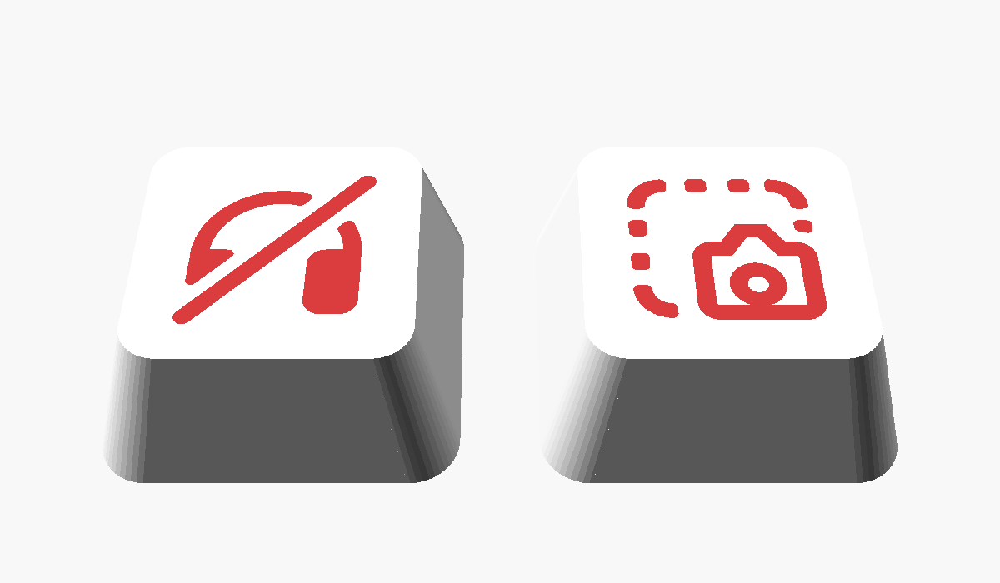

# Ikon-keycaps: Discord fullmute och Print Screen

Två keycaps med ikoner till stream decken: **Discord fullmute** (deafen, tangent 7)
och **Print Screen** (tangent 9). Keycap-formen är densamma som i emoji-generatorn
av Benoit Perocheau, men ikonerna är ritade som geometri eftersom emoji-typsnitt
saknar dem.



## Filer

| Fil | Används till |
|---|---|
| `stl/deafen_body.stl` + `stl/deafen_icon.stl` | Fullmute, ikonen i en andra färg (AMS) |
| `stl/printscreen_body.stl` + `stl/printscreen_icon.stl` | Print Screen, ikonen i en andra färg (AMS) |
| `stl/deafen_engraved.stl` | Fullmute i en färg, ikonen ingraverad 0,6 mm |
| `stl/printscreen_engraved.stl` | Print Screen i en färg, ikonen ingraverad 0,6 mm |
| `icon_keycaps.scad` | Källfilen, om du vill ändra storlek, höjd eller färg |

## Skriv ut i två färger (Bambu Studio + AMS)

1. Dra in **både** `deafen_body.stl` och `deafen_icon.stl` samtidigt.
2. På frågan *"Load these files as a single object with multiple parts?"*, svara **Ja**.
3. Högerklicka på delen *icon* i objektlistan och välj filament 2 (till exempel röd).
   Kroppen får filament 1 (till exempel vit).
4. Gör samma sak med `printscreen_body.stl` och `printscreen_icon.stl`.
5. Skriv ut som de ligger, med ovansidan mot plattan. Inget support behövs.
   0,2 mm lagerhöjd fungerar; ikonen är 0,4 mm tjock, alltså två lager.

Ikonen ligger spegelvänd på plattan, så den blir rättvänd när du vänder på
keycapen.

## Skriv ut i en färg

Skriv ut `*_engraved.stl` som den ligger. Ikonen blir en fördjupning i
ovansidan.

## Ändra

Öppna `icon_keycaps.scad` i OpenSCAD och ändra parametrarna överst:
`Icon_Size` (ikonens bredd, 11 mm), `Keycap_Height` (7,5 mm), `Icon_Depth`
och `Style`. Exportera sedan, till exempel:

```bash
openscad -D 'Icon="deafen"' -D 'Part="body"' -o stl/deafen_body.stl icon_keycaps.scad
```

```bash
openscad -D 'Icon="deafen"' -D 'Part="icon"' -o stl/deafen_icon.stl icon_keycaps.scad
```

## Licens

Keycap-formen kommer från emoji-keycap-generatorn av **Benoit Perocheau**, licens
**CC BY-NC-SA** (erkännande, icke-kommersiell, dela lika). Filerna i den här
mappen är en bearbetning av den och har samma licens. De omfattas alltså inte av
MIT-licensen som gäller för resten av repot. Ikonerna är egna ritningar i
OpenSCAD.
